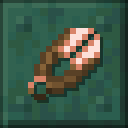

# Copper Shears

Shears made of copper. They work everywhere vanilla shears do, but wear out sooner.

Fabric mod for Minecraft 26.3 (Java 25, Mojang names). Requires Fabric API only. Singleplayer and server.

- Recipe: 2 copper ingots diagonally, like vanilla shears. Found in Tools & Utilities after the shears.
- Durability **150** (iron shears: 238). Repair with copper ingots on an anvil.
- Shears sheep, mooshrooms, snow golems, bogged; carves pumpkins; harvests honeycomb; disarms tripwire;
  gets shear drops from leaves, cobweb, grass, vines etc.; mines wool/leaves/cobweb fast; works in dispensers.

## Development

Full check (build, unit tests, in-game client gametest): `.\scripts\verify.ps1`. See `ROADMAP.md`.

License: CC0-1.0.
